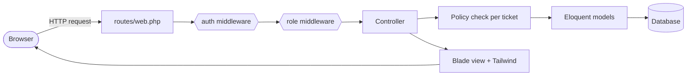
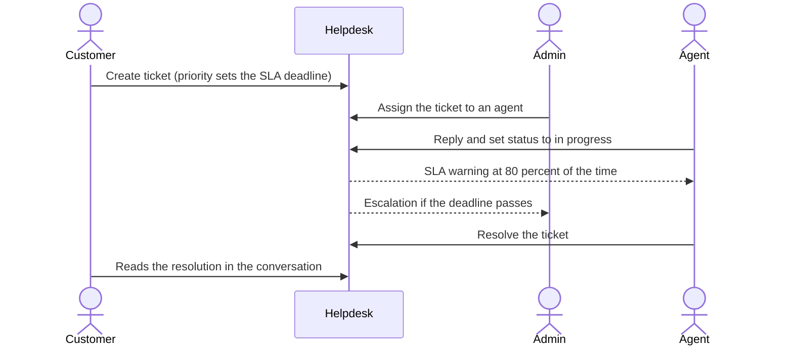
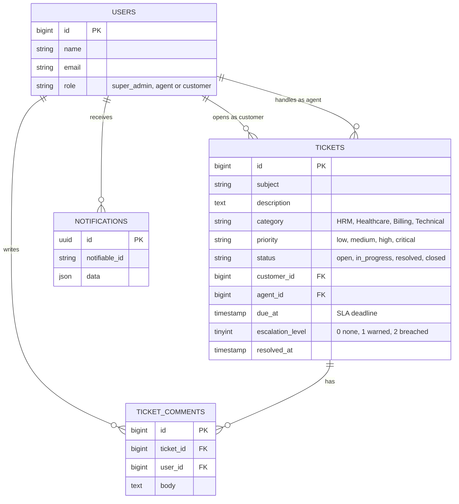
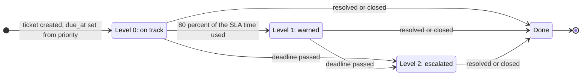
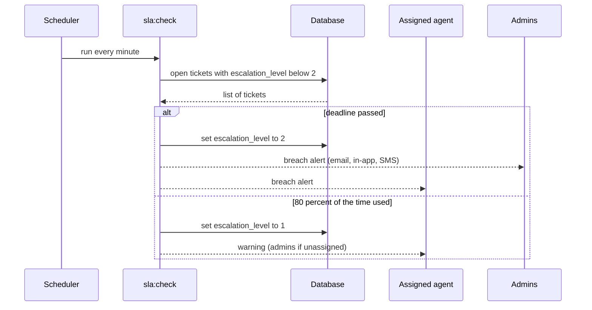
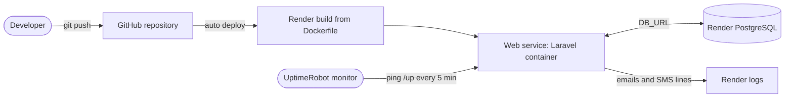
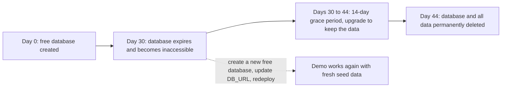

<div align="center">

# 🎫 Helpdesk Pro

**Role-based support ticketing with an automated SLA escalation engine.**
Built for HRM and healthcare support teams, where a missed deadline has real consequences.


### [🚀 Live demo](https://helpdesk-ticketing-system-cahv.onrender.com)

[Features](#-features) · <!-- [Screenshots](#-screenshots) · -->[How it works](#-how-it-works) · [Demo walkthrough](#-demo-walkthrough) · [Run locally](#-run-it-locally) · [Deploy](#-deployment-on-render) · [Free-tier limits](#-render-free-tier-limits-read-this)

</div>

---

## 📖 Overview

Support teams in HR and healthcare handle requests where timing matters: a payroll export that fails on the last day of the month, or a patient portal that won't let people log in. **Helpdesk Pro** gives each of those requests an owner and a deadline, and it **escalates automatically** when the deadline is in danger.

It is a complete, deployed Laravel application with three roles (Super Admin, Agent, Customer), strict per-ticket permissions, a conversation thread on every ticket, a dashboard, and a background engine that watches every open ticket against its SLA and alerts the right people by email, in-app notification and SMS.

**Why it is built this way:** the interesting problems in enterprise support software are *who may see what* and *what happens when nobody acts in time*. Those two problems are the core of this project, and each is covered by automated tests.

---

## 🌐 Live demo

**https://helpdesk-ticketing-system-cahv.onrender.com**

> ⏳ **First load can take about a minute.** The demo runs on a free hosting tier that puts the app to sleep after 15 minutes without visitors. The first request wakes it up. After that it responds normally.

### Demo accounts

| Role | Email | Password |
|---|---|---|
| 👑 Super Admin | `admin@example.com` | `password4216` |
| 🛠️ Agent | `agent@example.com` | `password4216` |
| 🙋 Customer | `customer@example.com` | `password4216` |

<!--
OWNER NOTE (delete before publishing):
- The hosted demo password is whatever you set as SEED_PASSWORD in Render.
- All three accounts share it. The Super Admin account can change every user's role,
  so think twice before publishing that password in a public README.
- Local installs (see "Run it locally") use the password: password
-->

On a local install the password for all three accounts is `password`.

**What you can see on the live site:** the dashboard counters, ticket lists filtered by role, the SLA deadline colouring, the admin user-management page and the full reply and status workflow. Alert emails and SMS lines are written to the server logs rather than sent to a real inbox, so they are not visible to visitors (see [Notifications](#-sla-and-escalation-engine)).

---

## ✨ Features

- **Role-based access control (RBAC).** Super Admin, Agent and Customer, enforced in two layers: middleware guards whole areas, and a policy decides access to each individual ticket.
- **SLA engine.** Every ticket gets a deadline from its priority (critical 2 h, high 8 h, medium 24 h, low 72 h). Rules live in one config file.
- **Automatic escalation.** A scheduled job warns the assigned agent at 80% of the SLA window and escalates to admins when the deadline passes. Each stage fires exactly once per ticket.
- **Multi-channel alerts.** Email, in-app (stored notifications) and an SMS channel (a logging stub, ready for a real gateway).
- **Ticket workflow.** Create, assign, reply, change status (open, in progress, resolved, closed), filter by status.
- **Dashboard.** Open, resolved, SLA-breached and escalated counters, scoped to what the signed-in user is allowed to see.
- **Admin console.** Promote or demote users between roles. Admins cannot change their own role.
- **Healthcare and HRM categories.** Tickets are categorised as HRM, Healthcare, Billing or Technical.
- **Tested.** Automated tests cover the permission rules and the escalation job.
- **Production-style deployment.** Multi-stage Docker build, migrations and seeding on boot, health check endpoint, HTTPS-aware proxy settings.

---

<!--
==========================================================================
SCREENSHOTS SECTION (HIDDEN)

HOW TO UNHIDE WHEN YOU HAVE IMAGES:
1. Create the folder docs/screenshots/ in the repo and save the images there
   using the file names below (PNG, about 1400px wide works well).
2. Delete the opening comment marker at the top of this block and the closing
   one at the bottom of it.
3. Near the top of this README, in the links line under the title, unhide the
   Screenshots link (it is wrapped in a comment too).
Delete any screenshot you do not have, together with its caption.
==========================================================================

## 📸 Screenshots

### 1. Dashboard

Four large counter cards: **Open**, **Resolved**, **SLA breached** and **Escalated**. The numbers are scoped to the user. A customer sees only their own tickets, an agent only the tickets assigned to them, and an admin sees everything.

### 2. Ticket list

A table with ticket code (`TCK-00042`), subject, category, colour-coded priority and status pills, the assigned agent, and the SLA deadline in plain words. Overdue deadlines turn **red and bold**. A status dropdown filters the list.

### 3. New ticket form

A clean form for customers: subject, category, priority and a description. The SLA deadline is calculated automatically from the chosen priority.

### 4. Ticket detail

The main screen: description and conversation on the left, a details card on the right (customer, agent, category, priority, SLA deadline, and an **Escalated to admins** badge when applicable), plus a management panel for admins and the assigned agent.

### 5. Admin: users and roles

A table of all users with an inline role dropdown. Your own row is locked and labelled "(you)".

### 6. SLA alerts

A captured alert email (or the matching log lines) such as "SLA BREACHED: TCK-00001 (Payroll export fails for March) is past its deadline.", plus the SMS line produced by the SMS channel.

### 7. Mobile view

The interface is responsive: on a phone the navigation collapses into a menu and tables scroll horizontally.

---
-->

## 🧠 How it works

### Request path

Every page follows the same route through the app. Access is checked twice before any data is returned.



### Who can do what

| Action | Customer | Agent | Super Admin |
|---|:---:|:---:|:---:|
| Create a ticket | ✅ | ❌ | ❌ |
| See a ticket | own tickets | assigned tickets | all tickets |
| Reply to a ticket | own tickets | assigned tickets | all tickets |
| Change ticket status | ❌ | assigned tickets | all tickets |
| Assign an agent | ❌ | ❌ | ✅ |
| Open the Users page / change roles | ❌ | ❌ | ✅ |
| Receive SLA warnings | ❌ | ✅ (assigned) | ✅ (breaches, unassigned tickets) |

The `role` column is deliberately **not mass-assignable**, so nobody can promote themselves by editing the registration form. New sign-ups are always customers.

### Life of a ticket



### Data model



---

## ⏱️ SLA and escalation engine

Deadlines come from `config/sla.php`, so business rules change without touching code:

| Priority | Time to resolve |
|---|---|
| Critical | 2 hours |
| High | 8 hours |
| Medium | 24 hours |
| Low | 72 hours |

A command, `php artisan sla:check`, runs **every minute** through Laravel's scheduler.





**Why it is safe to run constantly:** the `escalation_level` column makes the job *idempotent*. A ticket moves from level 0 to 1 to 2 and each alert is sent once, even if the job runs twice at the same moment.

### Notifications

| Channel | In this project |
|---|---|
| Email | Fully implemented. On the demo site `MAIL_MAILER=log`, so emails are written to the server log. Set SMTP variables to send real mail. |
| In-app | Stored in the `notifications` table. A bell icon in the UI is on the roadmap. |
| SMS | A working channel class that **logs** the message. Replace one line with an HTTP call to any SMS provider to go live. |

---

## 🎬 Demo walkthrough

A five-minute tour that shows every feature. Use the demo accounts above.

### Scenario: a critical healthcare ticket

1. **Sign in as the Customer** and click **New ticket**.
   Choose category *Healthcare*, priority *Critical*, write a subject such as "Clinic scheduling screen is frozen", and submit.
   ✅ *You land on the ticket page. The SLA deadline reads about 2 hours from now.*

2. **Open `/admin/users` as the Customer** (type it in the address bar).
   ✅ *You get a 403 Forbidden page. Customers cannot enter the admin area.*

3. **Sign out and sign in as the Super Admin.**
   ✅ *The dashboard counters include every ticket. The Tickets list shows all of them.*
   Open the new ticket and, in the management panel, **assign it to Agent Amy** and save.

4. **Sign in as the Agent.**
   ✅ *The list shows only tickets assigned to Amy. The customer's other tickets are invisible.*
   Open the ticket, post a reply, set the status to **In progress**, and save.

5. **Watch the SLA engine.** The seeded sample tickets are set up to trigger it:
   - *Payroll export fails for March* is already past its deadline and shows an **"Escalated to admins"** badge, with the deadline in red.
   - *Patient portal login errors* crossed 80% of its time, so the agent received a warning.
   - *Leave balance report request* is unassigned, so only an admin can pick it up.

   ✅ *The dashboard's **SLA breached** and **Escalated** counters are above zero.*

6. **Back as the Agent, resolve the ticket.** Set the status to **Resolved**.
   ✅ *The red deadline and escalation badge disappear, and the Resolved counter goes up.*

7. **As the Super Admin, open Users.** Promote a test user from Customer to Agent using the dropdown.
   ✅ *The change applies instantly. Your own row cannot be changed.*

> 💡 **Tip for a live demo:** to trigger a fresh escalation, create a *critical* ticket as the customer. Alerts appear in the server log within a couple of minutes of the deadline approaching.

### Seeded sample data

| Ticket | Category | Priority | Assigned to | Purpose |
|---|---|---|---|---|
| Payroll export fails for March | HRM | High | Agent Amy | Already past deadline, shows escalation |
| Patient portal login errors | Healthcare | Critical | Agent Amy | About 83% of time used, shows the warning |
| Leave balance report request | HRM | Low | nobody | Shows the admin assignment flow |

Because deadlines are relative to when the database was seeded, a long-running demo will show more tickets as breached over time. That is the engine working as designed.

---

## 💻 Run it locally

**Requirements:** PHP 8.2 or newer, Composer, Node 20 or newer, Git. On Windows and Mac, [Laravel Herd](https://herd.laravel.com) installs PHP, Composer and Node for you.

```bash
git clone https://github.com/YOUR-USERNAME/YOUR-REPO.git
cd YOUR-REPO

composer install
npm install

cp .env.example .env          # Windows PowerShell: copy .env.example .env
php artisan key:generate

php artisan migrate --seed    # SQLite file is created automatically
composer run dev              # starts the web server and the asset builder
```

Open **http://localhost:8000** and sign in with `admin@example.com` / `password`.

**With Laravel Herd:** instead of `composer run dev`, run `herd link` in the project folder, then `npm run dev`, and open `http://YOUR-FOLDER-NAME.test`.

**Try the SLA engine locally:**

```bash
php artisan sla:check         # run the check once, by hand
php artisan schedule:work     # or run it every minute like production
```

Alert emails and SMS lines appear in `storage/logs/laravel.log`.

### Run the tests

```bash
php artisan test
```

The suite covers: customers cannot open other customers' tickets, agents can open only assigned tickets, only admins can enter the admin area, and the SLA command escalates breached tickets to admins.

### Troubleshooting (Windows and Herd)

| Symptom | Fix |
|---|---|
| `Failed to listen on 127.0.0.1:8000` | Remove `PHP_CLI_SERVER_WORKERS` from `.env`. PHP's built-in server does not support workers on Windows. |
| `The [pcntl] extension is required to run Pail` | Harmless on Windows. Remove `php artisan pail` and the queue listener from the `dev` script in `composer.json`. |
| `Site not found` from Herd | Run `herd link` inside the project folder. |
| `419 Page Expired` after login, with "Deprecated" text on the page | On PHP 8.5, replace `PDO::MYSQL_ATTR_SSL_CA` in `config/database.php` with `(PHP_VERSION_ID >= 80500 ? \Pdo\Mysql::ATTR_SSL_CA : \PDO::MYSQL_ATTR_SSL_CA)` and keep the `=> env('MYSQL_ATTR_SSL_CA')` part. |
| `Vite manifest not found` | Run `npm run build` once. |

---

## 🐳 Docker

The `Dockerfile` is multi-stage: Node builds the CSS and JavaScript, then a PHP image installs dependencies and runs the app. `docker/start.sh` migrates the database, seeds the demo data, caches config, starts the scheduler in the background and launches the web server.

Test it locally before deploying (PowerShell):

```powershell
docker build -t helpdesk .

$key = php artisan key:generate --show
docker run --rm -p 8080:10000 `
  -e APP_KEY="$key" -e APP_ENV=local -e APP_DEBUG=true `
  -e APP_URL=http://localhost:8080 `
  -e DB_CONNECTION=sqlite -e DB_DATABASE=/tmp/app.sqlite `
  helpdesk sh -c "touch /tmp/app.sqlite && docker/start.sh"
```

Open **http://localhost:8080** (not `0.0.0.0`).

---

## ☁️ Deployment on Render



Every push to `main` rebuilds and redeploys automatically. On each start the container runs migrations and the seeder, both safe to repeat.

### Environment variables

| Key | Value |
|---|---|
| `APP_NAME` | Helpdesk Pro |
| `APP_ENV` | `production` |
| `APP_DEBUG` | `false` |
| `APP_KEY` | output of `php artisan key:generate --show` (starts with `base64:`) |
| `APP_URL` | your Render URL, with `https://` |
| `DB_CONNECTION` | `pgsql` |
| `DB_URL` | the database's **Internal Database URL** |
| `LOG_CHANNEL` | `stderr` |
| `MAIL_MAILER` | `log` (or `smtp` plus `MAIL_HOST`, `MAIL_PORT`, `MAIL_USERNAME`, `MAIL_PASSWORD`) |
| `SEED_PASSWORD` | the password for the three demo accounts. Use a long random value, for example from `php -r "echo bin2hex(random_bytes(10));"` |

`SEED_PASSWORD` is applied only when the accounts are first created. Changing it later does not change existing passwords. Use the Profile page for that.

Set the service's **health check path** to `/up`.

---

## ⚠️ Render free-tier limits (read this)

The live demo runs entirely on Render's free tier. Two limits matter, and the second one will eventually take the demo's data away.

### 1. The web service sleeps after 15 minutes

A free web service spins down after about 15 minutes without traffic and takes roughly a minute to wake up on the next request. Two consequences:

- The first visit after a quiet period is slow.
- The background SLA scheduler **pauses while the service is asleep**, because it lives inside the same container.

**Mitigation:** a free monitor at [uptimerobot.com](https://uptimerobot.com) requesting `https://helpdesk-ticketing-system-cahv.onrender.com/up` every 5 minutes keeps the service awake. Free instances also share a monthly pool of 750 instance hours per workspace, which is enough for one service to run continuously.

### 2. The free PostgreSQL database expires after 30 days

Render's free PostgreSQL databases **expire 30 days after they are created**. This is a hard limit of the free plan.



What it means in practice:

| Question | Answer |
|---|---|
| What happens on day 30? | The database becomes inaccessible. The app can no longer read its tickets or sessions, so pages start failing. |
| Can I keep the data? | Only by upgrading that database to a paid instance within the **14-day grace period**. After that Render deletes it, data included. |
| Are there backups? | **No.** Free Render databases do not support backups. |
| Can I just make another one? | Yes. After a free database expires you can create a new free one (one free database per workspace at a time). |
| Does the demo come back by itself? | Almost. The app re-creates its tables and demo accounts on boot, so only the data you created yourself is lost. |
| Does Render warn me? | It emails you as expiry and the end of the grace period approach. |

**How to renew the demo every 30 days (about 5 minutes):**

1. In the Render dashboard, create a **new** free PostgreSQL database in the same region as the web service.
2. Copy its **Internal Database URL**.
3. Open the web service, go to **Environment**, and replace the value of `DB_URL` with the new URL.
4. Save. Render redeploys, and on start the container runs the migrations and the seeder: tables, demo accounts (using `SEED_PASSWORD`) and sample tickets are created from scratch.
5. Delete the old expired database.

> 🗓️ **Put a recurring reminder in your calendar** for day 25 after each database creation.

**If you ever need to keep real data** (a backup before expiry, or a move to another host), export it with PostgreSQL's standard tool, using the database's *external* connection string from the Render dashboard:

```bash
pg_dump "EXTERNAL_DATABASE_URL" > backup.sql
```

**Alternatives for a longer-lived demo:** upgrade the Render database to a paid instance, or point `DB_URL` at a free PostgreSQL from another provider (for example Neon) whose free tier does not carry this 30-day expiry. Check each provider's current terms before relying on them. Because the app uses Laravel's database layer, switching only means changing `DB_URL`. MySQL works the same way (`DB_CONNECTION=mysql`).

*Limits quoted here come from Render's documentation as of October 2026. Check [render.com/docs/free](https://render.com/docs/free) in case they have changed.*

---

## 🗂️ Project structure

```
app/
├── Console/Commands/CheckSla.php        # the SLA escalation job (sla:check)
├── Http/
│   ├── Controllers/
│   │   ├── TicketController.php         # list, create, show, reply, update
│   │   ├── DashboardController.php      # counters scoped per role
│   │   └── Admin/UserController.php     # role management
│   └── Middleware/RoleMiddleware.php    # route-level role guard
├── Models/                              # User, Ticket, TicketComment
├── Notifications/
│   ├── SlaAlert.php                     # email, in-app and SMS payloads
│   └── SmsChannel.php                   # SMS channel (logging stub)
└── Policies/TicketPolicy.php            # per-ticket permissions
config/sla.php                           # SLA hours and warning threshold
database/{migrations,seeders}            # schema and demo data
resources/views/                         # Blade templates (tickets, admin, dashboard)
routes/{web.php,console.php}             # URLs and the every-minute schedule
tests/Feature/TicketAccessTest.php       # RBAC and SLA tests
Dockerfile · docker/start.sh             # production container
```

---

## 🧰 Tech stack

| Layer | Choice |
|---|---|
| Language and framework | PHP 8.4, Laravel 12 |
| Authentication | Laravel Breeze (Blade) |
| Front end | Blade templates, Tailwind CSS, Vite |
| Database | PostgreSQL in production, SQLite locally (MySQL-compatible) |
| Scheduling and alerts | Laravel scheduler, notifications (mail, database, custom SMS channel) |
| Testing | PHPUnit feature tests |
| Packaging and hosting | Docker (multi-stage), Render |

---

## 🛣️ Roadmap

- [ ] Real SMS gateway in `SmsChannel`
- [ ] Notification bell and unread list in the UI
- [ ] Queue worker so alerts never slow a request
- [ ] Business-hours SLAs (pause the clock nights and weekends)
- [ ] File attachments on tickets
- [ ] Audit log of status and assignment changes
- [ ] Vue or Livewire front end
- [ ] Nginx with PHP-FPM or FrankenPHP instead of the built-in server for heavy traffic
- [ ] Reports: average resolution time, SLA compliance by category

---

## 👤 Author

**YOUR NAME**
[GitHub](https://github.com/YOUR-USERNAME) · [LinkedIn](https://www.linkedin.com/in/YOUR-PROFILE)

Built as a portfolio project to demonstrate role-based access control, scheduled background processing and containerised deployment with Laravel.

## 📄 License

MIT. See `LICENSE` if you add one.
